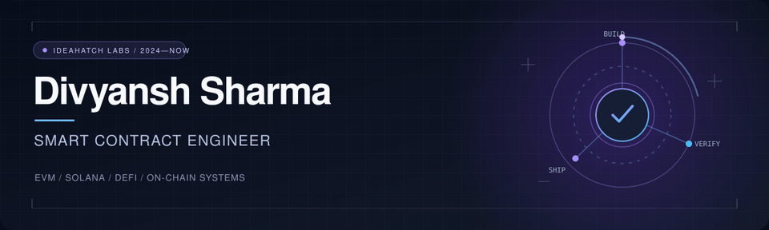

  

   

  **Senior Smart Contract Engineer at [IdeaHatch Labs](https://www.ideahatchlabs.com/)**  
  Building contracts for token ecosystems, launchpads, DeFi and on-chain games.

   

  
  
  
  

---

### What I work on

I develop and review smart contracts across EVM and Solana. My work spans contract architecture, staking and gaming logic, transaction flows, integrations and internal security reviews. Since 2024, I have worked as a Senior Smart Contract Engineer at IdeaHatch Labs.

### Selected projects

<table>
  <tr>
    <td width="50%" valign="top">
      <h3>01 / OneWave</h3>
      
Developed contracts alongside eight other developers for a token ecosystem covering presale, vesting, locking, staking, rewards, migration, treasury and governance. Contributed to implementation and testing ahead of deployment preparation and external audit.

      <a href="https://github.com/ShubhAgarwal0204/Wave-Smart-Contracts">View contract repository ↗</a>
    </td>
    <td width="50%" valign="top">
      <h3>02 / Memoo</h3>
      
Developed the smart contracts for a Solana launchpad and trading platform. Reviewed the contracts internally and addressed issues found during testing.

      <a href="https://memoo.fun">Explore Memoo ↗</a>
    </td>
  </tr>
  <tr>
    <td width="50%" valign="top">
      <h3>03 / Nutty DEX</h3>
      
Worked on smart contract development and blockchain integration for a live DEX.

      <a href="https://dex.nutty.fun/">Explore Nutty DEX ↗</a>
    </td>
    <td width="50%" valign="top">
      <h3>04 / MysticDAO</h3>
      
Refined and redeveloped the contracts for the staking and gaming parts of the project.

      <a href="https://mysticdao.io/">Explore MysticDAO ↗</a>
    </td>
  </tr>
</table>

### More Web3 work

| Project | Contribution |
| :--- | :--- |
| **KAKA PFP Generator** | Worked on Web3 features for the AI-powered PFP generator. |
| **KAKAFlip Telegram Bot** | Built transaction flows, RPC integration and the token transfer system. |
| **[Nailong](https://x.com/nailongmeme)** | Worked on market-making software for the project. |

### Toolkit

| Area | Tools and technologies |
| :--- | :--- |
| **Contracts** | Solidity, Rust, Anchor, EVM, Solana, OpenZeppelin |
| **Development** | Hardhat, Foundry, ethers.js |
| **Focus** | Contract architecture, testing, internal reviews, transaction systems |

### Beyond contracts

I also work with backend APIs, AI applications and automation. My main focus is making the on-chain logic reliable and connecting it cleanly to the product around it.

---

  <strong>Build with care. Review with intent. Ship with confidence.</strong>
    
  <a href="https://www.ideahatchlabs.com/">IdeaHatch Labs</a> · <a href="https://github.com/sharmadivyansh007">GitHub</a>

